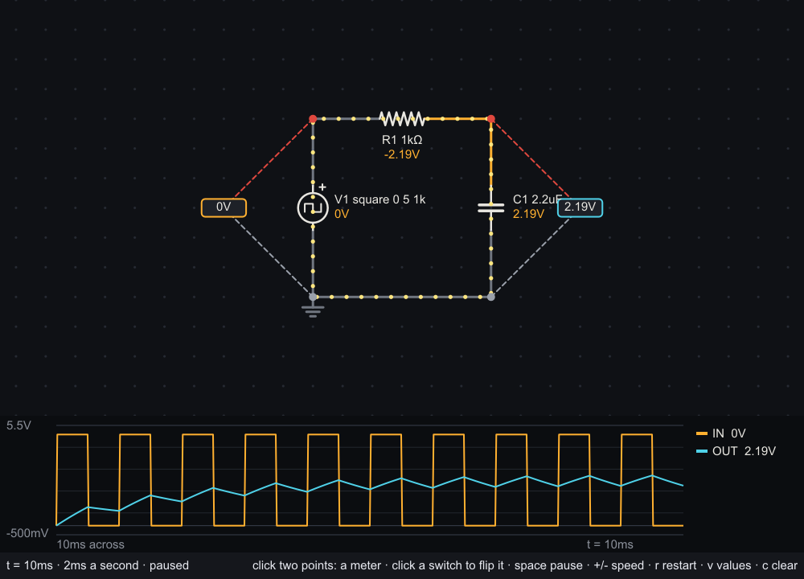

# amber

An analog circuit simulator in [sysl](https://sysl.sh), and a viewer that draws the circuit with the
voltage on every wire and the current moving through it. Named for *ēlektron*, the Greek for amber,
which is where the word "electricity" comes from.



## The viewer

```
sysl build app
app/amber-app examples/filter.amber
```

The circuit is switched on when the window opens, every capacitor empty, and its clock runs at the
speed the file asks for. Wires are grey at ground, warming to amber as their voltage rises (and cooling
to blue below ground); yellow dots move along the wires and through the parts the way the current
flows, faster for more current.

- **Click two grid points to put a voltmeter across them** — the red lead first, the black lead
  second; it reads the first point's voltage less the second's. **The scope** under the circuit draws
  what every meter has read over the last five seconds, each in its meter's colour.
- **Click a switch** to flip it; click any part for the voltage across it, the current through it and
  the power it takes or delivers.
- `space` pauses, `+` and `-` change the speed, `r` switches the circuit on again from empty, `v`
  toggles the voltage beside every part, `c` clears the meters, Escape quits.

`--shot out.png --time 10m` runs the circuit for ten milliseconds of its own time and draws that frame
to a PNG without a window; `--meter x1,y1,x2,y2` places a meter from the command line.

The examples: `led` (a battery, a resistor and an LED), `rc` (a capacitor charging when you close the
switch), `filter` (a square wave smoothed), `blink` (an LED on a square wave), `ring` (a capacitor
and an inductor trading energy) and `astable` (two transistors blinking two LEDs in turn, about once
a second).

## Schematics

A schematic is one element per line, placed on a grid; elements whose ends meet are connected, and an
end landing anywhere along a wire joins it:

```
# A low-pass filter.
speed 2m                                   # 2 ms of circuit time a second

source    V1  0 0  0 6  square 0 5 1k      # + end first
resistor  R1  0 0  6 0  1k
capacitor C1  6 0  6 6  2.2u
wire          6 6  0 6
ground        0 6
meter     OUT 6 0  6 6                     # red lead first
```

Parts: `resistor`, `capacitor`, `inductor`, `battery`, `source` (a wave), `current` (amps or a wave),
`switch` (`open` or `closed`), `diode`, `led` (`red`, `yellow`, `green`, `blue`), and the
transistors `npn` (`2N3904`, the default) and `pnp` (`2N3906`, the default). Also `wire`,
`ground`, `label` (names a node) and `meter`. Waves: `dc 5`, `sine 5 1k [offset]`,
`square 0 5 1k [duty]`, `pulse low high delay rise fall width period` (SPICE's), and
`pwl t v t v …`. Values take SPICE's suffixes: `4.7k`, `10u`, `1meg` (and `1m` is a milliohm).

A transistor is placed by three points — collector, base, emitter — with its base a square or more
off the line between the other two, which is where its symbol is drawn:

```
npn       Q1  4 10  8 12  4 14  2N3904     # collector, base, emitter
```

## SPICE netlists

```
sysl build cli
cli/amber-cli oracle/rc_pulse.cir
```

reads a SPICE netlist — the format published circuits and every other simulator use — runs its
analyses and prints their tables. The subset: `R`, `C` and `L` (with `IC=`), `V` and `I` sources
(DC, `PULSE`, `SIN`, `PWL`, with SPICE's defaults; an `AC` part is set aside), `D` with `.model … D`
(`IS`, `N`, `RS`, and an area), `Q` bipolar transistors (collector, base, emitter, an optional
substrate, a model and an area) with `.model … NPN` or `PNP` (`IS`, `BF`, `BR`, `NF`, `NR`, `VAF`,
`VAR`), `M` MOSFETs (drain, gate, source, bulk, a model, and `L=`, `W=` and `M=`, SPICE's 100 µm when
left off) with `.model … NMOS` or `PMOS` at level 1 (`VTO`, `KP`, `LAMBDA`), `.op`, `.tran` (with
`UIC`), `.dc`, `.end`; a `.control` block is skipped. What a netlist asks for that amber reads but does
not model — a diode's junction capacitance, a transistor's base resistance or high-injection knee, a
MOSFET's body effect (`GAMMA`, `PHI`, a bulk not on its source) or gate oxide, `.options` — is printed
as a note rather than dropped, and what would change the circuit and cannot be read (a junction
field-effect transistor, a MOSFET above level 1, a subcircuit, `.param`) is refused with its line.

**ngspice is the oracle.** The netlists in `oracle/` are run through ngspice 47 at a tolerance a
hundred times tighter than amber's by `oracle/generate.zsh`, which writes its answers into
`tests_oracle.sysl`; amber agrees with them to a few parts in ten million at an operating point and
along a sweep, and to within 0.2% of each waveform's swing through time (0.03% but for a resonant
circuit rung for twelve cycles and an astable multivibrator's steep edges).

## The library

`sh.sysl.amber` builds a circuit — from a schematic, or part by part — and solves it by modified
nodal analysis, with Newton–Raphson and SPICE's junction limiting for diodes and bipolar transistors
(`Transistor(NPN_2N3904)`, `connect3` for its collector, base and emitter) and its `fetlim` and
`limvds` for level-1 MOSFETs (`Mosfet(NMOS_2N7000, DEFAULT_W, DEFAULT_L)` or `PMOS_BS250`, `connect3`
for its drain, gate and source), and steps it through time
by the trapezoidal rule with its step chosen from the error it makes:

```
dependencies {
  amber { git = "github.com/sysl-lang/amber", version = "0.1.0" }
}
```

```sysl
import sh.sysl.amber.{circuit, sim, Dc, VoltageSource, Resistor, Capacitor, Switch}

var c = circuit()

c.connect("B1", VoltageSource(Dc(5.0)), "plus", "0")
c.connect("S1", Switch(false), "plus", "a")
c.connect("R1", Resistor(1000.0), "a", "top")
c.connect("C1", Capacitor(1e-6), "top", "0")

var s = sim(c)

s.power_on().unwrap()
s.set_switch(1, true)
s.advance_to(1e-3).unwrap()
print(s.voltage_at("top"))      // 5 (1 − e⁻¹) ≈ 3.16
```

`operating_point()` finds the circuit settled; `power_on()` starts it from empty; `advance_to(t)`
runs it to a time, landing on it exactly; `set_switch` and `set_wave` change it between steps. That
incremental shape is what lets a program — an emulated microcontroller, say — drive it as it runs. It
needs nothing but an allocator. What is planned is in [DESIGN.md](DESIGN.md).

```
sysl test .
```

runs the library's tests, the viewer's and the command line's.
