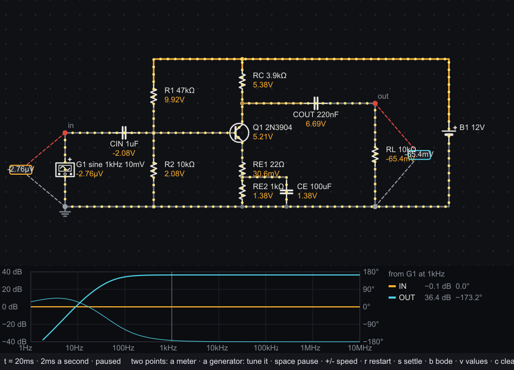
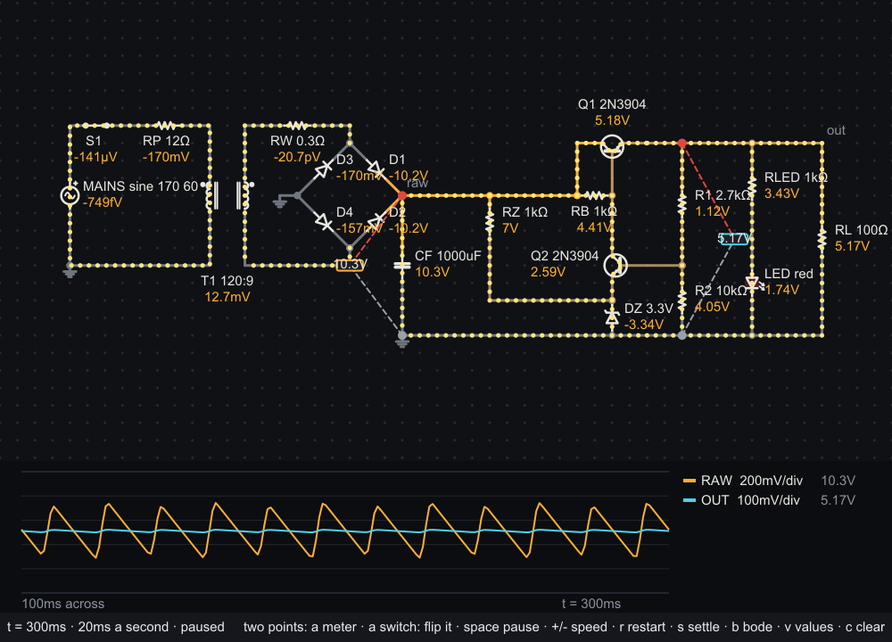

# amber

An analog circuit simulator in [sysl](https://sysl.sh), and a viewer that draws the circuit with the
voltage on every wire and the current moving through it. Named for *ēlektron*, the Greek for amber,
which is where the word "electricity" comes from.


## The viewer

```
sysl build app
app/amber-app examples/filter.amber
```

The circuit is switched on when the window opens, every capacitor empty, and its clock runs at the
speed the file asks for. Wires are grey at ground, warming to amber as their voltage rises (and cooling
to blue below ground); yellow dots move along the wires and through the parts the way the current
flows, faster for more current. A current that alternates keeps its dots through each zero crossing:
they slow, stop and come back the other way, moving against the most that branch has carried lately,
so a small signal beside a large bias still rocks where it can be seen.

- **Click two grid points to put a voltmeter across them** — the red lead first, the black lead
  second; it reads the first point's voltage less the second's. **The scope** under the circuit draws
  what every meter has read over the last five seconds, each in its meter's colour and on a vertical
  scale of its own, as a bench oscilloscope's channels are: each trace is centred on what it read and
  fills most of the height, the legend gives its volts a division (1, 2 or 5 times a power of ten)
  and how far it swings from top to bottom (`19.7mV p-p` in, `1.32V p-p` out: a gain of 67), and a
  mark at the left edge in its colour shows where its zero is.
- **Click a switch** to flip it; click any part for the voltage across it, the current through it and
  the power it takes or delivers.
- **Click a signal generator** to open its panel beside the scope: a waveform (sine, square,
  triangle or dc), and sliders for its frequency (a tenth of a hertz to a megahertz, a decade to the
  same length of slider), its amplitude (a millivolt to ten volts, likewise) and its offset. A change
  reaches the circuit at once, while its clock runs: nothing restarts, and the wave carries on from
  where it was in its cycle, as a bench generator's does. `close`, or a click anywhere else, puts the
  panel away; a restart keeps its settings.
- **Click a power supply** for its panel: regulated or raw, 50 or 60 Hz mains, and sliders for its
  voltage (to 30 V), its current limit (a milliamp to five amps) and a raw supply's ripple. Beside
  the supply its reading — volts, amps, and `CV` in green or `CC` in red — shows which it is holding,
  as does the lamp between its posts.
- `space` pauses, `+` and `-` change the speed, `r` starts the circuit again the way its file
  says (from empty, or settled where it says `start settled`), `s` starts it again settled at its DC
  operating point with every capacitor already charged, `v`
  toggles the voltage beside every part, `c` clears the meters, Escape quits.
- `b` swaps the scope for **a Bode plot**: each meter's gain (in decibels, the thick line) and phase
  (the thin one) from 1 Hz to 10 MHz, for a small sine from the signal generator. It is the circuit as
  it stands — the panels' settings are the ones it uses — linearised at its operating point, so a
  transistor is its gain there. A dim line marks the generator's own frequency, and the legend gives
  each meter's gain and phase at it.



`--shot out.png --time 10m` runs the circuit for ten milliseconds of its own time and draws that frame
to a PNG without a window; `--meter x1,y1,x2,y2` places a meter from the command line,
`--select G1` clicks an element, so a generator's panel can be drawn too, and `--bode` draws the Bode
plot in place of the scope.

The examples: `led` (a battery, a resistor and an LED), `rc` (a capacitor charging when you close the
switch), `filter` (a square wave smoothed), `blink` (an LED on a square wave), `ring` (a capacitor
and an inductor trading energy), `astable` (two transistors blinking two LEDs in turn, about once
a second), `cmos` (an NMOS and a PMOS inverting a switch's setting, to light an LED) and `amplifier`
(a 2N3904 common-emitter stage turning a generator's 10 mV at 1 kHz into about 660 mV, upside down;
turn the generator up past about 50 mV and the output clips), `two_stage` (two such stages coupled
through a capacitor: 2 mV in, about 1 V out the right way up, 54 dB, with a meter between the stages
showing each one's gain), `zener` (a raw supply's 2 V of ripple
cut to about 27 mV by a 5.1 V zener), `regulator` (a zener-referenced emitter follower: 4.87 V out
of a rippling 15 V, the ripple cut two-hundredfold) and `wallwart` (a 5 V supply that plugs into the
wall: 120 V at 60 Hz through a 120:9 transformer, a diode bridge and a 1000 µF reservoir, then a
series regulator with an error amplifier, holding 5.13 V while the reservoir ripples by 0.4 V; flip
S1 to unplug it).



## Schematics

A schematic is one element per line, placed on a grid; elements whose ends meet are connected, and an
end landing anywhere along a wire joins it:

```
# A low-pass filter.
speed 2m                                   # 2 ms of circuit time a second
start settled                              # begin at the DC operating point, not empty

source    V1  0 0  0 6  square 0 5 1k      # + end first
resistor  R1  0 0  6 0  1k
capacitor C1  6 0  6 6  2.2u
wire          6 6  0 6
ground        0 6
meter     OUT 6 0  6 6                     # red lead first
```

Parts: `resistor`, `capacitor`, `inductor`, `battery`, `source` (a wave), `current` (amps or a wave),
`gen` (a signal generator, below), `supply` (a bench power supply, below), `switch` (`open` or
`closed`), `diode`, `led` (`red`, `yellow`, `green`, `blue`), `zener` (its breakdown voltage), and the
transistors `npn` (`2N3904`, the default) and `pnp` (`2N3906`, the default), and the MOSFETs `nmos`
(`2N7000`, the default) and `pmos` (`BS250`, the default). Also `wire`,
`ground`, `label` (names a node) and `meter`. Waves: `dc 5`, `sine 5 1k [offset]`,
`square 0 5 1k [duty]`, `triangle -1 1 1k` (low, high, frequency), `pulse low high delay rise fall
width period` (SPICE's), and `pwl t v t v …`. Values take SPICE's suffixes: `4.7k`, `10u`, `1meg`
(and `1m` is a milliohm).

A signal generator is a bench instrument: a waveform (`sine`, `square`, `triangle` or `dc`), a
frequency, an amplitude (the peak, from the offset), and perhaps an offset and an output resistance,
50 Ω unless the line says otherwise. It is placed by its output and its return, and a meter across
them reads what reaches the circuit: the wave less what the output resistance drops. A `dc` generator
puts out its offset, keeping its frequency and amplitude for when it is switched back to a wave.

```
gen       G1  2 5  2 10  sine 1k 10m             # output, return; 10 mV at 1 kHz from 50 Ω
gen       G2  0 0  0 4   square 50 2.5 2.5 600   # 0 to 5 V at 50 Hz from 600 Ω
```

A bench power supply is `supply <name> <+> <−> <volts> <amps> [raw <ripple> [50|60 [<ohms>]]]`.
Regulated, it holds its voltage until the load would draw more than its current limit, then holds the
limit and lets the voltage fall (CV and CC). `raw` makes it what a transformer, rectifier and
capacitor give: the voltage on average, a sawtooth ripple peak to peak at twice the mains frequency
(50 Hz unless it says 60), behind an internal resistance (1 Ω unless it says) it sags across.

```
supply    P1  0 0  0 8   12 1                    # 12 V, limited to 1 A
supply    P2  0 0  0 8   15 500m raw 2 60 1.5    # 15 V raw, 2 V of 120 Hz ripple, 1.5 Ω
zener     DZ  6 8  6 0   5.1                     # anode, cathode; breaks down at 5.1 V
```

A transformer is placed by four points, its primary's two ends and then its secondary's, the first
of each its dotted end, and given its turns ratio (and perhaps its primary's inductance, 10 H unless
it says). Its windings are coupled at 0.999, and it carries what a real one has without being drawn:
a gigohm of insulation between its windings and 10 kΩ of core loss across its primary. A source
straight across a winding has no DC answer, since at DC a winding is a wire; put the winding's
resistance in series, as `wallwart` does.

```
transformer T1  10 2  10 10  12 2  12 10  120:9   # primary, secondary, turns ratio
```

A transistor is placed by three points — collector, base, emitter — with its base a square or more
off the line between the other two, which is where its symbol is drawn:

```
npn       Q1  4 10  8 12  4 14  2N3904     # collector, base, emitter
```

A MOSFET is placed the same way, by drain, gate and source, with its gate a square or more off the
line between the other two; its width and length are the library's defaults (100 µm each):

```
nmos      M1  4 10  2 12  4 14  2N7000     # drain, gate, source
```

## SPICE netlists

```
sysl build cli
cli/amber-cli oracle/rc_pulse.cir
```

reads a SPICE netlist — the format published circuits and every other simulator use — runs its
analyses and prints their tables. The subset: `R`, `C` and `L` (with `IC=`), `K` coupling two
inductors into a transformer (`K1 LP LS 0.999`), `V` and `I` sources
(DC, `PULSE`, `SIN`, `PWL`, with SPICE's defaults; `AC magnitude [phase]` drives it for `.ac`; a triangle is a
`PULSE` with no top, `PULSE(low high 0 T/2 T/2 0 T)`), `D` with `.model … D`
(`IS`, `N`, `RS`, `BV` and `IBV` for a zener's breakdown, and an area), `Q` bipolar transistors (collector, base, emitter, an optional
substrate, a model and an area) with `.model … NPN` or `PNP` (`IS`, `BF`, `BR`, `NF`, `NR`, `VAF`,
`VAR`), `M` MOSFETs (drain, gate, source, bulk, a model, and `L=`, `W=` and `M=`, SPICE's 100 µm when
left off) with `.model … NMOS` or `PMOS` at level 1 (`VTO`, `KP`, `LAMBDA`), `.op`, `.tran` (with
`UIC`), `.dc`, `.ac dec|oct|lin` (each node's `vdb`, `vp`, `vr` and `vi`, SPICE's names for a
phasor's decibels, phase in radians, and real and imaginary parts), `.end`; a `.control` block is
skipped. What a netlist asks for that amber reads but does
not model — a diode's junction capacitance, a transistor's base resistance or high-injection knee, a
MOSFET's body effect (`GAMMA`, `PHI`, a bulk not on its source) or gate oxide, `.options` — is printed
as a note rather than dropped, and what would change the circuit and cannot be read (a junction
field-effect transistor, a MOSFET above level 1, a subcircuit, `.param`) is refused with its line.

**ngspice is the oracle.** The netlists in `oracle/` are run through ngspice 47 at a tolerance a
hundred times tighter than amber's by `oracle/generate.zsh`, which writes its answers into
`tests_oracle.sysl`; amber agrees with them to a few parts in ten million at an operating point and
along a sweep, and to within 0.2% of each waveform's swing through time (0.03% but for a resonant
circuit rung for twelve cycles and an astable multivibrator's steep edges); the whole wall supply,
transformer to regulated output, switched on from empty, agrees through its first 100 ms. Across
frequency, an RLC band-pass, a transformer and three amplifiers, a bipolar stage, a MOSFET stage and
the two-stage amplifier, agree to a few parts in ten million.

## The library

`sh.sysl.amber` builds a circuit — from a schematic, or part by part — and solves it by modified
nodal analysis, with Newton–Raphson and SPICE's junction limiting for diodes and bipolar transistors
(`Transistor(NPN_2N3904)`, `connect3` for its collector, base and emitter) and its `fetlim` and
`limvds` for level-1 MOSFETs (`Mosfet(NMOS_2N7000, DEFAULT_W, DEFAULT_L)` or `PMOS_BS250`, `connect3`
for its drain, gate and source), and steps it through time
by the trapezoidal rule with its step chosen from the error it makes:

```
dependencies {
  amber { git = "github.com/sysl-lang/amber", version = "0.1.0" }
}
```

```sysl
import sh.sysl.amber.{circuit, sim, Dc, VoltageSource, Resistor, Capacitor, Switch}

var c = circuit()

c.connect("B1", VoltageSource(Dc(5.0)), "plus", "0")
c.connect("S1", Switch(false), "plus", "a")
c.connect("R1", Resistor(1000.0), "a", "top")
c.connect("C1", Capacitor(1e-6), "top", "0")

var s = sim(c)

s.power_on().unwrap()
s.set_switch(1, true)
s.advance_to(1e-3).unwrap()
print(s.voltage_at("top"))      // 5 (1 − e⁻¹) ≈ 3.16
```

`operating_point()` finds the circuit settled; `power_on()` starts it from empty; `advance_to(t)`
runs it to a time, landing on it exactly; `set_switch` and `set_wave` change it between steps. That
incremental shape is what lets a program — an emulated microcontroller, say — drive it as it runs.
`Generator(wave, ohms)` is a bench signal generator, its wave behind an output resistance, and an
`Oscillator` (`oscillator(Waveform.Sine, 1000.0, 10e-3)`) makes its wave and, `retuned` at the moment
of a change, carries its phase across it. `Supply(regulated(12.0, 1.0))` or
`Supply(raw_supply(15.0, 1.0, 2.0))` is a bench power supply, changed with `set_supply` and read with
`current_limited`; `zener_model(5.1)` is a zener. `response(hertz, drives)` answers a small sine:
each source in `drives` (`drive(part, amplitude, degrees)`) driven at that frequency, every voltage
and current comes back as a `Complex[real]` phasor, the circuit linearised at its operating point. It
needs nothing but an allocator. What is planned is in [DESIGN.md](DESIGN.md).

```
sysl test .
```

runs the library's tests, the viewer's and the command line's.
